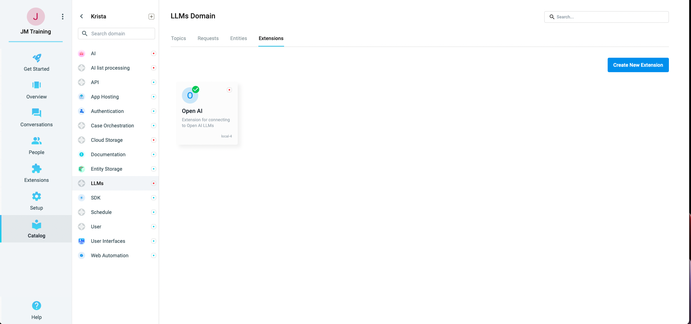
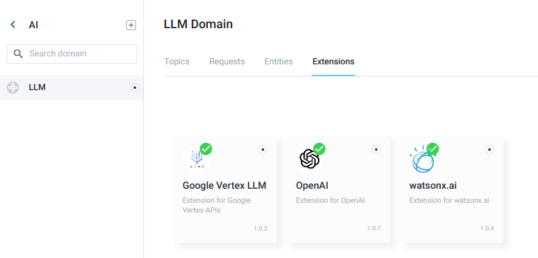
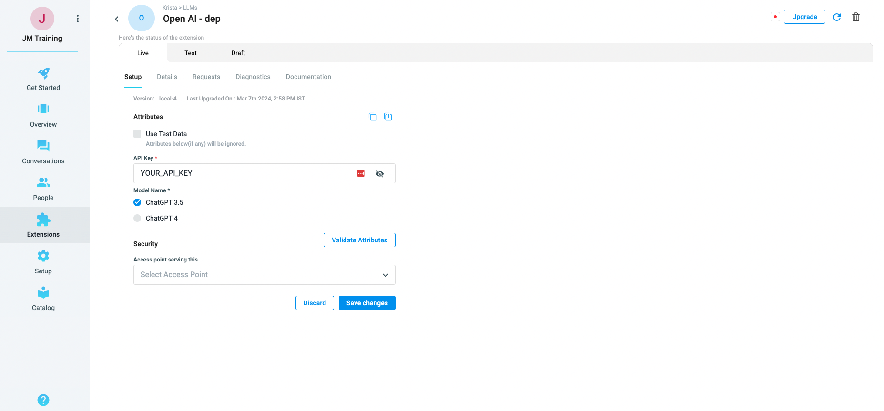
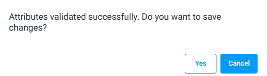

# Extension Configuration

## Overview

This guide explains how to configure the MS Azure OpenAI Extension in Krista. You'll learn about the required configuration parameters, step-by-step setup process, and best practices for secure configuration.

## Configuration Parameters

The following table lists all configuration parameters required to set up the Azure OpenAI extension:

| Parameter | Type | Required | Description | Example |
|-----------|------|----------|-------------|---------|
| API Key | Text (Secured) | Yes | Azure OpenAI API key from your Azure resource | "a1b2c3d4e5f6..." |
| Model Name | Pick One | Yes | The language model to use for queries | "ChatGPT 4" or "ChatGPT 3.5" |
| Service URL | Text | Yes | Azure OpenAI endpoint URL from your resource | "https://myresource.openai.azure.com/" |

### Parameter Details

#### API Key
- **Purpose**: Authenticates requests to your Azure OpenAI service
- **Security**: Stored securely and encrypted in Krista
- **Source**: Obtained from Azure portal under "Keys and Endpoint"
- **Format**: 32-character alphanumeric string
- **Validation**: Tested during connection validation

#### Model Name
- **Purpose**: Specifies which language model to use for processing requests
- **Options**: 
  - **ChatGPT 3.5**: GPT-3.5 Turbo model (faster, cost-effective)
  - **ChatGPT 4**: GPT-4 model (advanced reasoning, higher cost)
- **Selection**: Choose based on your use case and budget requirements
- **Deployment**: Must match a deployed model in your Azure OpenAI resource

#### Service URL
- **Purpose**: Specifies the endpoint for your Azure OpenAI resource
- **Format**: `https://[resource-name].openai.azure.com/`
- **Source**: Found in Azure portal under "Keys and Endpoint"
- **Region**: URL reflects the Azure region where your resource is deployed
- **Validation**: Must be accessible and properly formatted

## Step-by-Step Setup

### 1. Access Extension Catalog

1. Navigate to **Catalog → Krista → AI → LLMs → Extensions**
2. Locate **"MS Azure OpenAI"** extension
3. Click to view extension details

### 2. Add Extension to Workspace

1. Click **"Add to Workspace"** button
2. Choose your target workspace
3. Provide a descriptive name for the extension instance
4. Click **"Add"** to proceed to configuration

### 3. Configure Parameters

Enter the required configuration parameters:

1. **API Key**: Paste your Azure OpenAI API key
   - Ensure no extra spaces or characters
   - Key will be masked for security
2. **Model Name**: Select from dropdown
   - Choose "ChatGPT 4" for advanced tasks
   - Choose "ChatGPT 3.5" for general use
3. **Service URL**: Enter your Azure OpenAI endpoint
   - Include the full URL with https://
   - Ensure it ends with a forward slash

### 4. Validate Configuration

1. Click **"Validate Attributes"** button
2. System will test connection to Azure OpenAI
3. Wait for validation to complete
4. Confirm successful validation message

> **✅ Success**: You should see a green toast message confirming successful validation.

### 5. Save Configuration

1. Review all entered parameters
2. Click **"Save"** to store the configuration
3. Extension is now ready for use

## Authentication Type Selection

The Azure OpenAI extension uses **API Key Authentication**:

- **Method**: Bearer token authentication using Azure OpenAI API key
- **Security**: Keys are encrypted and stored securely in Krista
- **Rotation**: Supports key rotation through Azure portal
- **Scope**: Full access to deployed models in your Azure OpenAI resource

## Security Considerations

### API Key Management
1. **Secure Storage**: Never store API keys in plain text
2. **Access Control**: Limit who can view/modify extension configuration
3. **Key Rotation**: Regularly rotate API keys in Azure portal
4. **Monitoring**: Monitor API usage through Azure portal

### Network Security
1. **HTTPS Only**: All communication uses encrypted HTTPS
2. **IP Restrictions**: Configure IP allowlists in Azure if needed
3. **Private Endpoints**: Use Azure private endpoints for enhanced security
4. **Firewall Rules**: Configure Azure firewall rules as required

### Best Practices
1. **Principle of Least Privilege**: Grant minimum required permissions
2. **Environment Separation**: Use different resources for dev/test/prod
3. **Audit Logging**: Enable Azure audit logging for compliance
4. **Regular Reviews**: Periodically review access and configurations

## Troubleshooting

### Common Configuration Issues

#### Invalid API Key
**Error Message**: "Azure OpenAI API Key is required. Please provide a valid API key from your Azure OpenAI resource. You can find this in the Azure portal under 'Keys and Endpoint'."
**Causes**:
- Empty or missing API key field
- API key not properly copied from Azure portal
- Whitespace or formatting issues

**Resolution**:
1. Log into Azure portal and navigate to your Azure OpenAI resource
2. Go to "Keys and Endpoint" section
3. Copy either Key 1 or Key 2 exactly as shown
4. Paste into the API Key field without extra spaces
5. Ensure the key is a 32-character alphanumeric string

#### Model Selection Issues
**Error Message**: "Model selection is required. Please choose either 'ChatGPT 3.5' or 'ChatGPT 4' from the dropdown menu. Ensure the selected model is deployed in your Azure OpenAI resource."
**Causes**:
- No model selected from dropdown
- Selected model not deployed in Azure resource
- Model deployment still in progress
- Mismatch between Krista selection and Azure deployment

**Resolution**:
1. Select either "ChatGPT 3.5" or "ChatGPT 4" from the dropdown
2. Log into Azure portal and check your OpenAI resource
3. Navigate to "Model deployments" section
4. Ensure the corresponding model is deployed:
   - For "ChatGPT 3.5": Deploy gpt-35-turbo or gpt-35-turbo-16k
   - For "ChatGPT 4": Deploy gpt-4 model
5. Wait for deployment status to show "Succeeded"
6. Retry the configuration validation

#### Connection Test Failures
**Error Message**: "Unable to connect to Azure OpenAI service. Please verify: (1) Your API key is correct and active, (2) Your Service URL is properly formatted (e.g., https://your-resource.openai.azure.com/), (3) The selected model is deployed in your Azure resource, (4) Your network allows HTTPS connections to Azure."
**Causes**:
- Incorrect Service URL format
- API key issues
- Network connectivity problems
- Model not deployed
- Azure service issues

**Resolution**:
1. **Verify Service URL**: Copy exact endpoint from Azure portal "Keys and Endpoint" section
2. **Check API Key**: Ensure API key is valid and active
3. **Confirm Model Deployment**: Verify selected model is deployed in Azure
4. **Test Network**: Ensure firewall allows HTTPS to *.openai.azure.com
5. **Check Azure Status**: Verify Azure OpenAI service is operational
6. **Retry**: Wait a moment and try validation again

#### Network Connectivity
**Symptoms**: Connection timeouts or network errors  
**Causes**:
- Firewall blocking outbound connections
- Azure resource network restrictions
- DNS resolution issues

**Resolution**:
1. Check firewall rules for outbound HTTPS
2. Verify Azure resource network settings
3. Test DNS resolution of endpoint URL

## Advanced Configuration

### Rate Limiting
The extension includes built-in rate limiting:
- **Calls**: 15 calls per minute (actual limit: 30)
- **Tokens**: 8,000 tokens per minute (80% of 10,000 limit)
- **Automatic**: Handles rate limiting transparently

### Model Parameters
Default model parameters are optimized for balanced performance:
- **Temperature**: 0.3 (precise) to 0.8 (creative)
- **Top P**: 0.2 (precise) to 0.8 (creative)
- **Max Tokens**: 512 response tokens
- **Context**: 4,096 input tokens

## See Also

- [Creating Azure OpenAI App](/pages/CreatingAzureOpenAIApp.md) - Set up Azure OpenAI resource
- [Authentication](/pages/Authentication.md) - Understand authentication details
- [Ask LLM](/pages/AskLLM.md) - Start using the configured extension
